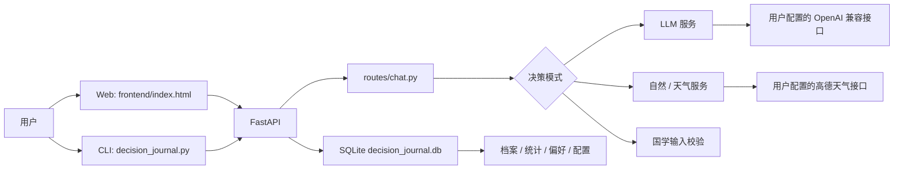

# 《别纠结》项目交接文档

> 项目：`decision-journal-master`  
> 当前公开版本：`v0.9.0`  
> 文档基准：2026-08-13，按当前工作区代码和资产整理  
> 产品名称：别纠结（Decision Journal）

## 1. 这是什么

《别纠结》是一个本地优先的 AI 决策辅助工具。用户输入一句纠结的问题，也可以补充图片或语音；系统按所选视角生成一份决策简报，并把记录存到本机 SQLite。

它的目标不是替用户下结论，而是把问题拆成理由、风险、选项和下一步。高风险事项仍应由用户自己核实并承担决定。

当前有三个实际入口：

| 入口 | 用途 | 入口文件 |
| --- | --- | --- |
| Web 桌面界面 | 日常使用、设置、档案、统计、随机动画 | `frontend/index.html`，由 FastAPI 挂载 |
| CLI | 终端或 Agent 调用聊天、档案、统计、配置 | `scripts/decision_journal.py` |
| Skill 描述 | 告诉 Agent 何时及如何调用 CLI | `skills/decision-journal/SKILL.md` |

项目不是纯前端页面。Web 和 CLI 最终都请求同一个 FastAPI 服务，并共用同一份 SQLite 数据库。

## 2. 当前状态与接手重点

- 版本号为 `0.9.0`，变更记录在 `CHANGELOG.md` 和 `docs/releases/v0.9.0.md`。
- 后端是 Python/FastAPI，前端是原生 HTML/CSS/JavaScript，没有 Node 构建步骤。
- LLM 与高德天气都不内置凭据，必须由使用者自行配置。
- 面向用户的“风水”已改为“国学”，但内部模式 id 仍是 `fengshui`。这是兼容旧数据、CLI 参数、API 和前端逻辑的约定，不要直接改名。
- 随机模式有六种浏览器实时绘制的效果，不是预渲染视频。
- 项目根目录目前有未跟踪的 `.playwright-cli/` 和 `mp4/`，以及已修改的 README、前端和文档文件。接手时先执行 `git status --short`，不要把它们当作本次交接文档自动产生的改动。

## 3. 快速启动

### 3.1 开发环境

要求：Python 3.9 及以上。当前环境已验证过 Python 3.13。

```powershell
cd E:\Object\decision-journal-master
python -m venv .venv
.venv\Scripts\Activate.ps1
pip install -e ".[dev]"
```

只运行应用也可以：

```powershell
pip install -r requirements.txt
```

### 3.2 启动 Web 与 API

```powershell
cd E:\Object\decision-journal-master\backend
python main.py
```

默认地址：

- Web：`http://127.0.0.1:8010/`
- Swagger：`http://127.0.0.1:8010/docs`
- 健康检查：`http://127.0.0.1:8010/api/health`

热重载：

```powershell
cd E:\Object\decision-journal-master\backend
uvicorn main:app --reload --host 127.0.0.1 --port 8010
```

`backend/main.py` 启动时会初始化数据库、注册 API 路由，并把 `frontend/` 作为静态资源挂载。前端直接从同源 `/api/*` 请求后端，不需要单独开前端服务器。

### 3.3 CLI

CLI 假定后端已经运行：

```powershell
cd E:\Object\decision-journal-master
python scripts/decision_journal.py -q "该不该接受这份新工作" -m rational
python scripts/decision_journal.py -q "今晚吃什么" -m random
python scripts/decision_journal.py --action archive
python scripts/decision_journal.py --action stats
```

默认 API 地址为 `http://127.0.0.1:8010`。后端不在默认端口时，用 `--base-url` 指定。

## 4. 运行结构



主请求路径：

1. Web 的 `frontend/scripts/chat.js` 或 CLI 发送 `POST /api/chat`。
2. `backend/routes/chat.py` 合并本次请求传入的配置与本地有效配置。
3. `auto` 模式先由 `backend/services/mode_recognizer.py` 按关键词选择实际模式。
4. `nature` 进入自然与天气流程；其余模式进入 `backend/services/llm_service.py`。
5. 结果被标准化为 `brief`、`result`、`reply` 等字段，随后自动写入 SQLite。
6. Web 用 `frontend/scripts/brief.js` 渲染模式对应的结果卡；档案和统计再从 API 读取同一份数据库。

## 5. 目录与职责

```text
decision-journal-master/
├── backend/
│   ├── main.py                 FastAPI 入口、静态资源挂载、8010 端口
│   ├── config.py               配置优先级、敏感字段脱敏、用户偏好
│   ├── db.py                   SQLite 表初始化、决策与配置读写
│   ├── models/schemas.py       Pydantic 请求与响应模型
│   ├── routes/                 Chat、档案、单条决策、统计、配置、模式、TTS
│   └── services/               LLM、模式识别、天气、自然参考、评分、国学输入校验、提示词
├── frontend/
│   ├── index.html              主界面 DOM 骨架
│   ├── styles/                 桌面、聊天、档案、统计、设置、皮肤和预览页样式
│   ├── scripts/                页面模块与 API 封装
│   ├── assets/logo-nav.png     沿用小程序的导航 Logo
│   ├── vendor/zdog.dist.min.js 立体骰子使用的本地库
│   └── random-effects-preview.html  六种随机效果的独立预览页
├── scripts/decision_journal.py CLI / Skill 入口
├── tests/                      pytest、Playwright 和可选集成测试
├── docs/                       GitHub Pages、README 截图、GIF、发布说明
├── dist/skill-intro/           60 秒竖版介绍视频、封面和 HyperFrames 源工程
├── README.md                   中文 README
├── README.en.md                English README
├── skills/decision-journal/    唯一可安装 Skill 包与使用说明
│   └── SKILL.md
├── CHANGELOG.md                版本变更
├── DISCLAIMER.md               风险与隐私边界
├── ACKNOWLEDGEMENTS.md          开源引用与致谢
└── PROJECT_HANDOVER.md         本文档
```

### 前端模块速查

| 文件 | 主要职责 |
| --- | --- |
| `scripts/api.js` | 同源 API 请求封装，以及六种模式的前端注册表 |
| `scripts/app.js` | 应用启动、侧栏、抽屉、主题、皮肤、偏好加载 |
| `scripts/chat.js` | 文本/图片/语音输入、发送、自动模式提示、对话回答回存 |
| `scripts/brief.js` | 六类结果卡、自然证据、随机效果渲染、档案结果恢复 |
| `scripts/archive.js` | 档案分页、详情、已执行/后悔标记、删除 |
| `scripts/stats.js` | 总数、执行率、后悔率、平均信心、模式分布、7 天趋势 |
| `scripts/settings.js` | LLM、天气、语言、主题、皮肤、价值偏好、TTS 设置 |
| `scripts/voice.js` | Web Speech 输入；优先 Edge TTS，失败后回退浏览器朗读 |
| `scripts/i18n.js` | 简中、繁中、英文、法文、日文、西班牙文 |
| `scripts/random-preview.js` | 随机效果预览页重播和皮肤切换 |

## 6. 决策模式与实现边界

| 模式 id | 前台名称 | 实现 | 适合什么 | 注意事项 |
| --- | --- | --- | --- | --- |
| `auto` | 自动 | `mode_recognizer.py` 的关键词规则路由 | 不确定如何开始 | 实际返回的 `mode` 会是路由后的具体模式 |
| `rational` | 理性 | LLM 返回利弊和结论；`decision_score.py` 根据问题、利弊与价值观补充评分 | 成本较高、后悔成本高的选择 | 价值观权重来自偏好：效率、风险、成长、关系 |
| `random` | 随机 | LLM 或 Demo 提供 6 个选项；前端随机选择效果并显示结果 | 低风险小事 | 仅用于打破僵局，不应用于重要决定 |
| `nature` | 自然 | `weather_service.py` 获取高德或模拟天气；`nature_signal.py` 生成参考值；可再交给 LLM 写解读 | 想换个观察角度 | 没有完整高德配置时明确返回模拟自然数据 |
| `dialogue` | 对话 | LLM/Demo 返回一个追问和 3 个回答；前端选择后写入 `dialogueHistory` | 有答案但说不出口 | 当前是一轮一问一答的累积，不是有服务端会话状态的连续 Agent |
| `fengshui` | 国学 | LLM/Demo 结果结合 `bazi_engine.py` 的出生信息提取与基础年柱/时辰校验 | 传统文化角度的参考 | 对外称“国学”，内部 id 不改；本地引擎并不完成完整四柱、大运、十神排盘 |

### 自动路由规则

`mode_recognizer.py` 用固定关键词优先级路由。比如“吃什么”优先随机，“八字/运势”进入 `fengshui`，“辞职/买房/创业”等进入理性，“不敢/纠结”进入对话，“恋爱/旅行/情绪”等进入自然；没有命中时默认理性。

这不是模型分类器。修改关键词会直接改变自动模式行为，改前应补 `tests/test_services.py` 和 `tests/test_routes.py` 的覆盖。

### 理性评分

`decision_score.py` 生成六项数值：`benefit`、`risk`、`cost`、`reversibility`、`valueFit`、`confidence`。它是启发式规则：高风险和高可逆关键词、利弊数量、用户价值权重共同影响分数。它不是概率模型，也不应被描述为精确评估。

### 国学模式的真实边界

`bazi_engine.py` 当前能解析生日、性别、出生地、时辰和历法标记，计算年柱并给出时辰/五行的基础提示。月柱、日柱、完整四柱、大运流年、十神格局都没有在本地实现。`prompts.py` 中要求外部 LLM 参照 bazi-skill 的完整流程，但这不能等同于仓库内置了完整排盘能力。

## 7. API 清单

| 方法 | 路径 | 用途 |
| --- | --- | --- |
| `GET` | `/api/health` | 健康检查，返回名称、状态、版本 |
| `POST` | `/api/chat` | 提交问题、模式、可选图片和临时配置；自动存档 |
| `GET` | `/api/modes` | 六种模式元数据和快捷问题 |
| `GET` | `/api/archive?page=1&pageSize=20` | 分页读取档案 |
| `POST` | `/api/decision` | 新增或覆盖一条决策 |
| `GET` | `/api/decision/{id}` | 读取单条决策 |
| `PATCH` | `/api/decision/{id}` | 仅更新 `executed`、`regret`、`dialogueHistory` |
| `DELETE` | `/api/decision/{id}` | 删除一条决策 |
| `GET` | `/api/stats` | 总数、分布、平均信心、执行率、后悔率、7 天趋势 |
| `GET` | `/api/config` | 读取脱敏后的 LLM/天气配置状态 |
| `POST` | `/api/config` | 写入非空配置到 SQLite |
| `DELETE` | `/api/config` | 删除 SQLite 中全部 API 配置 |
| `GET` | `/api/preferences` | 读取语言、皮肤、价值观、Demo、TTS 等偏好 |
| `POST` | `/api/preferences` | 合并保存偏好 |
| `GET` | `/api/tts/voices` | 读取内置 Edge TTS 音色表 |
| `GET` | `/api/tts/speak` | 流式返回 MP3 音频 |

### `POST /api/chat` 关键字段

```json
{
  "question": "要不要换城市生活",
  "mode": "nature",
  "image": "data:image/png;base64,...",
  "apiKey": "临时 LLM Key",
  "llmModel": "gpt-4o-mini",
  "llmBaseUrl": "https://api.openai.com/v1",
  "weatherKey": "高德 Key",
  "weatherBaseUrl": "https://restapi.amap.com/v3/weather/weatherInfo",
  "weatherCity": "北京"
}
```

`image` 是可选 base64 data URL。前端限制上传图片为 5MB；真实视觉分析取决于用户选择的模型是否支持图片。

返回主要字段：

```json
{
  "brief": { "summary": "...", "confidence": 72, "perspectives": [], "nextSteps": [], "risks": [] },
  "nature": null,
  "mode": "rational",
  "reply": "...",
  "result": {},
  "autoRecognized": { "mode": "rational", "reason": "...", "confidence": 76 },
  "decisionId": "dec_..."
}
```

自然模式使用 `nature` 字段，通常不会有普通 `brief`。未配置 LLM 且没有主动开启 Demo 时，`/api/chat` 返回 HTTP `402`。

## 8. 配置、密钥与本地数据

### 8.1 配置优先级

配置优先级从高到低：

1. `/api/chat` 请求内临时字段，或 CLI flag。
2. 环境变量。
3. SQLite `config` 表，由 Web 设置页或 CLI `--action config-api --save-to-db` 写入。
4. `~/.decision-journal/config.json`，由 CLI `config --save` 或 `--save-config` 写入，保留给旧流程兼容。

相关实现：`backend/config.py`、`scripts/decision_journal.py`。

### 8.2 环境变量

```powershell
$env:DECISION_JOURNAL_LLM_API_KEY = "..."
$env:DECISION_JOURNAL_LLM_MODEL = "gpt-4o-mini"
$env:DECISION_JOURNAL_LLM_BASE_URL = "https://api.openai.com/v1"
$env:DECISION_JOURNAL_WEATHER_KEY = "..."
$env:DECISION_JOURNAL_WEATHER_BASE_URL = "https://restapi.amap.com/v3/weather/weatherInfo"
$env:DECISION_JOURNAL_WEATHER_CITY = "北京"
```

LLM 真实调用必须同时有 Key、模型和 Base URL。天气实时调用必须同时有高德 Key 与 Base URL；城市可空，后端会用北京作为默认查询城市。`DECISION_JOURNAL_WEATHER_APPSECRET` 和 `weather_appsecret` 是旧版兼容字段，会被当作天气 Key 处理，不应再用于新文案或新代码。

### 8.3 Web 设置与 CLI 配置

Web：设置页分别保存 AI 配置、天气配置和用户偏好。API 回显不会返回 Key 明文，只会返回是否已配置。

CLI 保存到 SQLite：

```powershell
python scripts/decision_journal.py --action config-api --save-to-db `
  --api-key "..." `
  --llm-model "gpt-4o-mini" `
  --llm-base-url "https://api.openai.com/v1" `
  --weather-key "..." `
  --weather-base-url "https://restapi.amap.com/v3/weather/weatherInfo" `
  --weather-city "北京"
```

旧式文件配置：

```powershell
python scripts/decision_journal.py config --save `
  --api-key "..." --llm-model "gpt-4o-mini" --llm-base-url "https://api.openai.com/v1"
```

### 8.4 SQLite

数据库位置：`backend/decision_journal.db`。该文件及 WAL/SHM 文件被 `.gitignore` 忽略。

| 表 | 内容 |
| --- | --- |
| `decisions` | 问题、模式、完整结果 JSON、简报 JSON、创建时间、是否执行、是否后悔、对话记录 |
| `config` | API 配置和 `preferences` JSON |

数据库使用 WAL 模式。每次获取连接都会开启 `journal_mode=WAL` 与外键检查。

重要安全现实：SQLite 里的 API Key 目前是明文存储。代码会在 API 与 CLI 回显时掩码，但磁盘并未加密。不要把 `decision_journal.db`、`.env`、`~/.decision-journal/config.json`、带私密内容的截图或视频提交到仓库。

## 9. LLM、Demo、图片与语音

### LLM

- 协议：OpenAI 兼容 `chat/completions`。
- `llm_base_url` 可以填到 `/v1`，后端会补 `/chat/completions`；也可以直接填完整 endpoint。
- 请求使用 Bearer Token，温度固定 `0.7`，超时 `15` 秒。
- LLM 返回应为 JSON。服务会处理 JSON 代码块和夹带文本，然后对不同模式补齐必要字段。
- API Key 不应出现在日志中。

### Demo

`preferences.demo_mode` 默认 `false`。没有真实 LLM 配置时：

- Demo 未启用：聊天接口返回 `402`，前端提示用户去设置或主动体验 Demo。
- Demo 启用：服务返回结构正确的模拟结果，结果标识为 mock。

Demo 是产品预览，不是 AI 调用。涉及“真实分析”“模型能力”的文案不要把它和真实 LLM 混在一起。

### 图片

前端通过 FileReader 把图片编码为 data URL 后放到 `/api/chat` 的 `image` 字段。真实调用时后端改用 OpenAI 多模态消息格式。是否真的识别图片由用户配置的模型决定。

### 语音

- 输入：浏览器 Web Speech API。浏览器不支持时麦克风按钮隐藏。
- 输出：优先请求后端 Edge TTS 接口；失败、超时或无服务时回退浏览器 `SpeechSynthesis`。
- Edge TTS 音色表写死在 `backend/routes/tts.py`，不是运行时拉取。

## 10. 自然模式与天气

天气服务为高德 Web API，接口 URL 不再内置，用户在设置页、CLI 或环境变量里填写。完整配置后，后端会使用同一 URL 连续请求：

- `extensions=base`：实时天气。
- `extensions=all`：未来预报。

真实数据会回填城市、天气、气温、湿度、风、更新时间、预报和趋势；`nature_signal.py` 根据实际/降级数据生成参考权重。高德接口不可用、Key/Base URL 不完整时，会使用带 `source`、`isReal: false`、`weatherStatus: not_configured` 的模拟自然数据，前端会明确显示模拟原因。

自然模式不应写成“预测”。它只是把天气、时间、月相和预报信息组织成一个观察角度。

## 11. 随机模式与视觉效果

随机模式先得到 6 个候选项和一个随机结果，再由 `frontend/scripts/brief.js` 从以下效果中随机选一种展示：

1. 指针盘
2. 签筒
3. 立体骰子
4. 六张抽卡
5. 纸条机
6. 墨迹择路

立体骰子依赖本地 `frontend/vendor/zdog.dist.min.js`。六种效果都在浏览器渲染，不使用视频素材。

独立预览页：`http://127.0.0.1:8010/random-effects-preview.html`。该页支持重播每种效果，并可切换四套皮肤，适合做视觉回归检查。

## 12. 主题、皮肤与语言

偏好保存在 SQLite 的 `preferences` 中：

- 主题：`light`、`dark`、`auto`。
- 皮肤：`heritage`、`workbench`、`journal`、`console`。
- 语言：`zh-CN`、`yue`、`en`、`fr`、`ja`、`es`。
- 默认模式、Logo id、自动朗读、TTS 语速/音调/音色、四项价值权重、Demo 开关。

皮肤的用户可见名称分别是“原来的样子”“安静工作台”“决策日志”“模块化工作台”。Logo 资产为 `frontend/assets/logo-nav.png`，沿用了小程序版的 Logo。更新 Logo 时还要同步 `docs/images/logo-nav.png` 和 `dist/skill-intro/hyperframes-v7/assets/logo-nav.png`，否则产品、GitHub 页面和介绍视频会出现不一致。

## 13. 测试与验证

### 13.1 全量测试

```powershell
cd E:\Object\decision-journal-master
pytest -q
```

最近一次可复现结果：`87 passed, 15 skipped`。其中 15 个 skip 是运行中服务集成测试默认访问 `http://localhost:8765`，服务未启动时会主动跳过。

### 13.2 桌面 UI 测试

`tests/test_desktop_ui.py` 不是自己启动服务，它默认访问 `http://127.0.0.1:8010`。跑完整 `pytest` 前，要先在另一个终端启动后端：

```powershell
cd E:\Object\decision-journal-master\backend
python main.py
```

然后：

```powershell
cd E:\Object\decision-journal-master
pytest tests/test_desktop_ui.py -q
```

这组用例验证：桌面布局、侧栏与抽屉、设置页的高德模拟说明、统计刷新、立体骰子、六种随机效果、四套皮肤、自然详情证据、对话回答写入 `dialogueHistory`。

### 13.3 运行中服务集成测试

集成测试默认 `http://localhost:8765`，可指定目标地址：

```powershell
$env:DECISION_JOURNAL_TEST_BASE_URL = "http://127.0.0.1:8010"
pytest tests/test_integration.py -q
```

这组会写配置、档案和偏好。不要对含真实个人数据与真实 Key 的正式数据库运行它；建议使用测试环境或临时工作副本。

### 13.4 改动后的最低检查

| 改动 | 至少执行 |
| --- | --- |
| 后端路由、配置、服务 | `pytest tests/test_config.py tests/test_routes.py tests/test_services.py -q` |
| SQLite | `pytest tests/test_db.py -q` |
| 前端布局、设置、动画 | 启动 8010 后跑 `pytest tests/test_desktop_ui.py -q`，并人工看预览页 |
| 文案、i18n、README | 搜索旧品牌、旧天气描述和错误的 `fengshui` 前台文案 |
| 发布视频或 GIF | `ffprobe` 核对尺寸、时长、音轨；人工看首尾帧和字幕 |

## 14. 文档、GitHub Pages 与发布资产

### 14.1 README 与 GitHub Pages

- 中文 README：`README.md`
- 英文 README：`README.en.md`
- GitHub Pages 中文介绍：`docs/index.html`
- GitHub Pages 英文介绍：`docs/index-en.html`
- 发布说明：`docs/releases/v0.9.0.md`

README 顶部使用：

- `docs/images/intro-animation-preview-zh.gif`
- `docs/images/intro-animation-preview-en.gif`

更新功能、Logo、皮肤、天气配置或随机效果时，应同步检查中英文 README、两份 Pages 页面、`CHANGELOG.md` 和发布说明，避免介绍内容与实际产品脱节。

### 14.2 截图与 GIF

`docs/images/` 保存 README/Pages 所用的中英文界面截图、Logo 和介绍 GIF。文件名以 `-zh`、`-en` 区分。README 引用这些文件，不要随意改名。

### 14.3 60 秒介绍视频

清理后保留的最终资产在 `dist/skill-intro/`：

| 文件 | 用途 | 已核验规格 |
| --- | --- | --- |
| `decision-journal-skill-intro-final-1080x1920.mp4` | 最终竖版介绍视频 | 1080×1920、约 60.01 秒、H.264 + AAC |
| `cover-gbro-apimart-collage-v2-3x4.png` | 3:4 封面方案 | 1536×2048 |
| `cover-gbro-apimart-product-final-3x4.png` | 3:4 封面方案 | 1536×2048 |
| `hyperframes-v7/` | 介绍视频的 HyperFrames HTML 源工程和素材 | 可用于改台词、图片、字幕、节奏后重新导出 |

`hyperframes-v7/assets/audio/` 中保留口播、字幕、转录和配乐；`assets/cards/`、`assets/skins/`、`assets/story/` 是视频使用的截图与叙事图。修改视频前不要只改 MP4，应保留或更新源工程，方便下次迭代。

### 14.4 已清理范围

此前只清理过 `dist/skill-intro` 的旧导出、临时预览和冗余工作目录；最终视频、两张封面和当前 HyperFrames 工程被保留。不要把 `dist/skill-intro` 当作随意缓存目录继续堆放中间产物。新的草稿建议放在明确的临时目录，定稿后只保留源工程和最终交付件。

## 15. 已知问题与维护风险

1. **（已修复 2026-11-13）README 与包元数据的 Codex Skill 字样已清除**，统一改为“可安装 Skill（decision-journal）/ installable Skill”；唯一 Skill 入口位于 `skills/decision-journal/SKILL.md`。对外文案更新时仍需区分“保留 Skill”与“删掉 Codex 这个限定词”。
2. **（已修复 2026-11-13）`.env.example` 地址已更新**为实际默认服务 `http://127.0.0.1:8010/`。
3. **`backend/README.md` 的接口表不完整。** 实际还有单条决策 CRUD、配置、偏好和 TTS 路由。根 README 和本交接文档较完整；后端 README 需要以后同步。
4. **集成测试含旧字段断言。** `tests/test_integration.py` 有对 `weather.hasAppid` 的旧字段检查，而当前 API 用 `hasKey` / `hasBaseUrl`，并保留 `hasAppsecret` 兼容名。默认服务未启动时该文件被跳过，所以此问题未体现在常规 `87 passed, 15 skipped` 中。要启用集成测试前应先修正。
5. **国学模式不要被夸大。** 代码层的八字引擎只做输入提取、年柱和时辰基础校验；完整排盘依赖外部能力或 LLM 提示，不能声称本地已实现完整命理系统。
6. **明文 Key 的本地存储。** SQLite 与兼容配置文件没有做加密；本地优先不等于自动加密。任何发布、备份、打包都要排除它们。
7. **用户数据会出站。** 配置第三方 LLM 后，问题和图片会发送给该 LLM；使用天气时城市信息会发送给天气服务；Edge TTS 会把朗读文本交给语音服务。免责声明和设置文案不能删除这些说明。
8. **外部服务失败有降级。** 高德失败会转模拟自然数据；Edge TTS 失败会转浏览器朗读；真实 LLM 不可用时只有用户主动开启 Demo 才会得到模拟结果。

## 16. 接手后的建议顺序

1. 运行 `git status --short`，确认当前未提交改动归属。
2. 启动 `backend/main.py`，访问健康检查与主页。
3. 运行后端/配置/服务测试，再启动 8010 跑桌面 UI 测试。
4. 在设置页填测试用的 OpenAI 兼容配置，分别验证理性、随机、自然、对话和国学。
5. 用 `random-effects-preview.html` 检查六种效果和四套皮肤。
6. 修改任何面向用户的名称或功能说明时，同步检查 README 中英、Pages 中英、i18n、`CHANGELOG.md` 和发布说明。
7. 修改 Logo、视频或封面时，同步检查前端、`docs/images/` 和 `dist/skill-intro/hyperframes-v7/assets/` 的同名资产。

## 17. 关键兼容约定

- CLI 文件名：`scripts/decision_journal.py`
- Python 包 / console script：`decision-journal`
- 国学模式内部 id：`fengshui`
- 旧天气字段：`weather_appsecret`、`DECISION_JOURNAL_WEATHER_APPSECRET`、API 响应中的 `hasAppsecret`
- 本地兼容配置：`~/.decision-journal/config.json`
- 默认 Web/API 端口：`8010`

这些标识可能看起来不够统一，但已被 README、CLI、历史数据、测试或旧客户端引用。除非做明确的迁移与兼容层，否则不要一次性改名。

## 18. 相关文档

- `README.md`：中文产品与安装说明
- `README.en.md`：英文说明
- `skills/decision-journal/SKILL.md`：CLI / Skill 参数与返回结构
- `CHANGELOG.md`：版本变更
- `docs/releases/v0.9.0.md`：当前版本发布说明
- `DISCLAIMER.md`：高风险决策、隐私、第三方服务边界
- `ACKNOWLEDGEMENTS.md`：第三方引用和致谢
- `CONTRIBUTING.md`：贡献约束
- `SECURITY.md`：安全问题反馈方式
