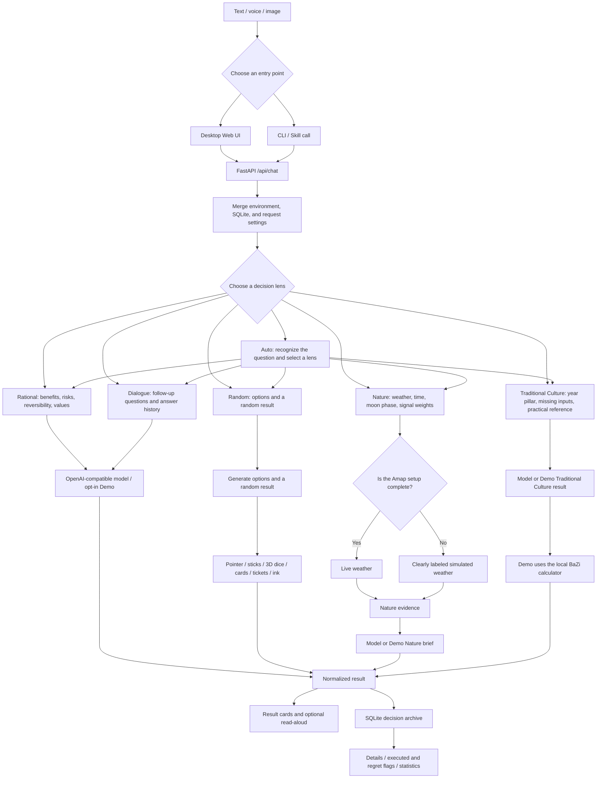
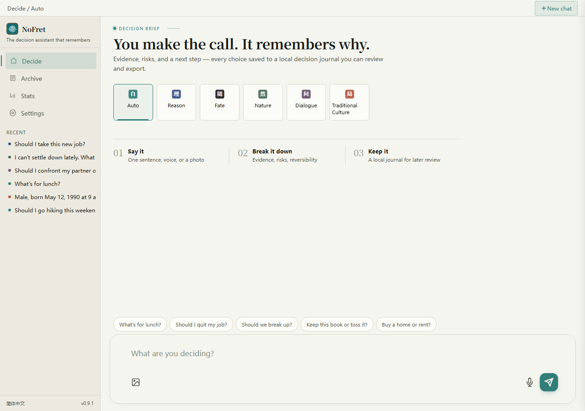
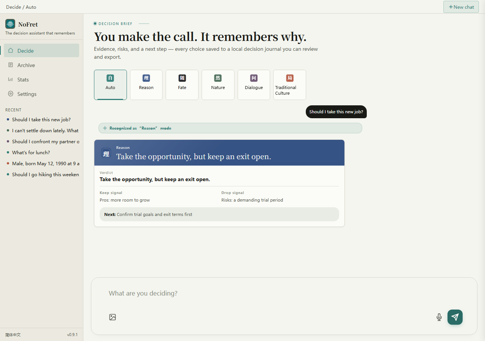
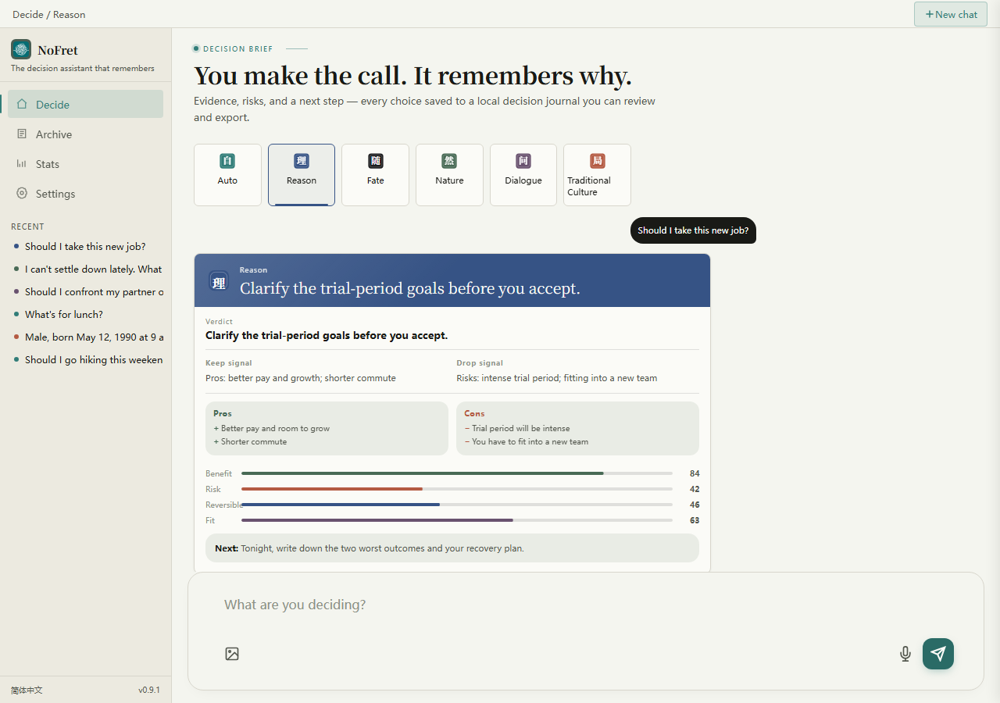
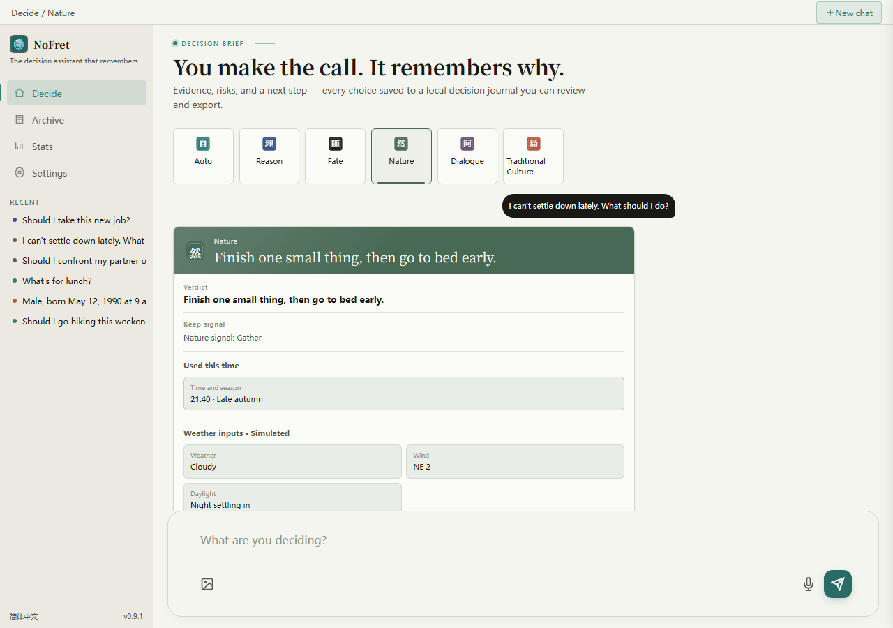
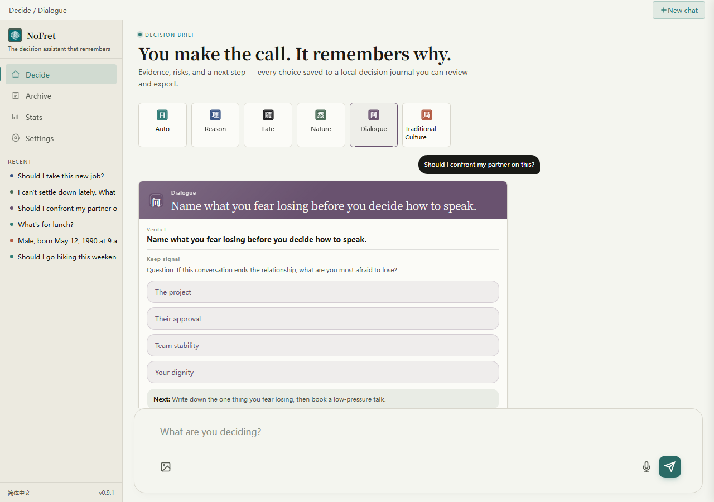
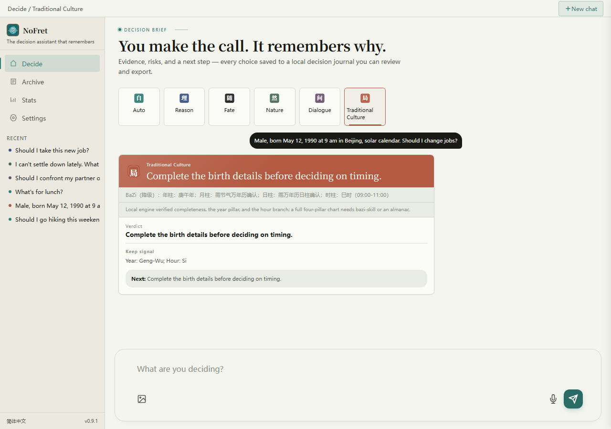
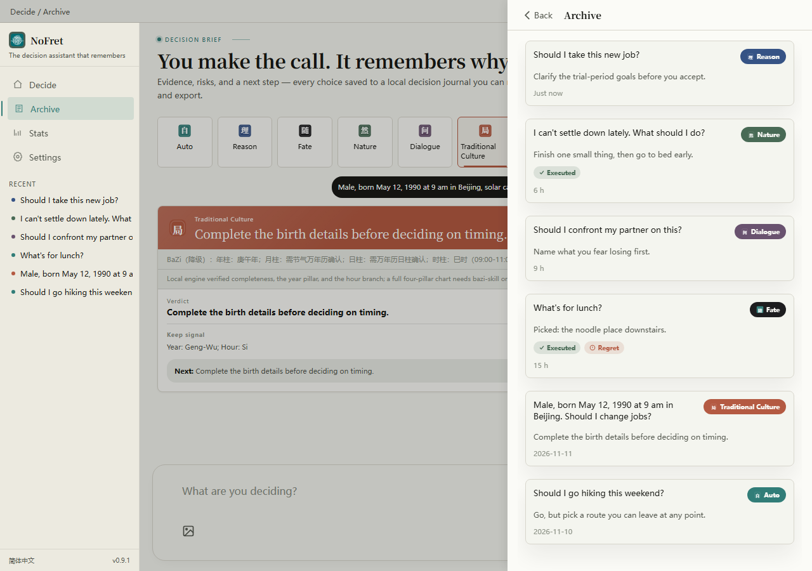
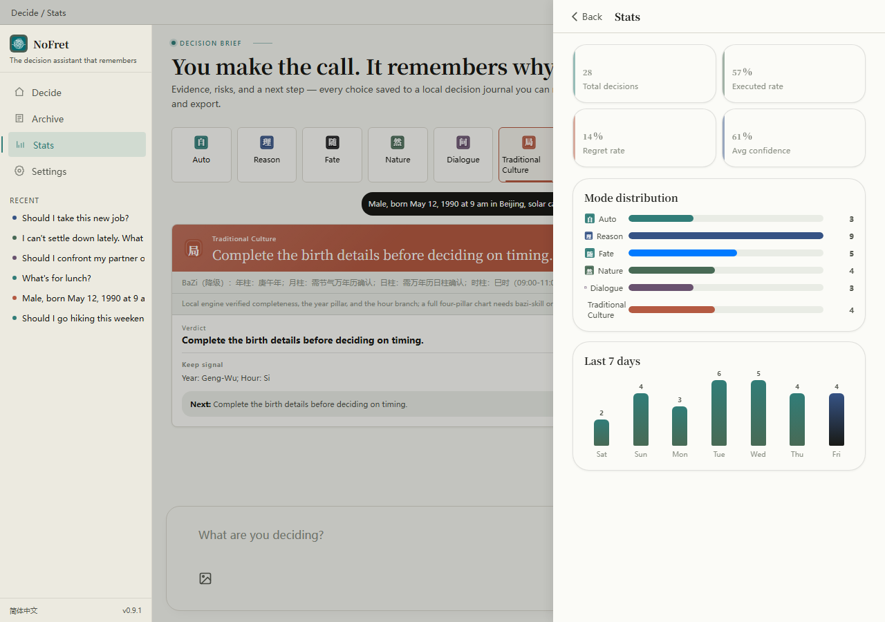
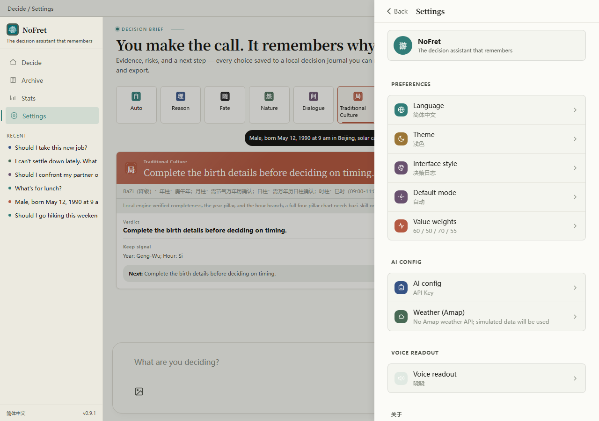

# Decision Journal · 别纠结

<p align="center">
  <strong>The decision assistant that remembers.</strong><br>
  You make the call; it remembers why.<br>
  One sentence becomes evidence, risks, and a next step — every choice is saved to a local decision journal you can review and export.
</p>

<p align="center"><a href="https://github.com/mianbaofang/decision-journal/releases"></a> <a href="https://github.com/mianbaofang/decision-journal/actions/workflows/ci.yml"></a> <a href="https://github.com/mianbaofang/decision-journal/blob/master/LICENSE"></a></p>

<p align="center">
  <a href="https://mianbaofang.github.io/decision-journal/index-en.html">
    
  </a>
</p>

<p align="center">
  <a href="README.md">中文</a>
  ·
  <a href="skills/decision-journal/SKILL.md">Installable Skill</a>
  ·
  <a href="https://mianbaofang.github.io/decision-journal/">Chinese Intro</a>
  ·
  <a href="https://mianbaofang.github.io/decision-journal/index-en.html">English Intro</a>
  ·
  <a href="DISCLAIMER.md">Disclaimer</a>
  ·
  <a href="ACKNOWLEDGEMENTS.md">Acknowledgements</a>
  ·
  <a href="docs/releases/v0.10.1.md">v0.10.1 Release Notes</a>
  ·
  <a href="SECURITY.md">Security</a>
  ·
  <a href="PRIVACY.md">Privacy</a>
  ·
  <a href="https://github.com/mianbaofang/decision-journal/issues/new/choose">Feedback</a>
</p>

<table align="center">
  <tr>
    <th>Before deciding</th>
    <th>After deciding</th>
    <th>Take it with you</th>
  </tr>
  <tr>
    <td>Six lenses for benefits, risks, reversibility, and a smallest next step</td>
    <td>Execution and regret markers, execution rate, regret-rate review</td>
    <td>One command exports <code>.brief.md</code> — archive it, share it, diff it</td>
  </tr>
</table>

## Quick Start

Three ways to install — pick one:

**1) One line to install the Skill into your agent** (Claude Code / Codex / OpenClaw, etc.):

```bash
npx skills add mianbaofang/decision-journal
```

**2) PyPI install for the CLI + Web UI** (adds a `decision-journal` command that auto-starts the local backend):

```bash
pip install decision-journal
decision-journal -q "Should I take the new job?" --demo
```

**3) Development install from source**:

```bash
pip install -e ".[dev]"
cd backend
python main.py
```

Then say to your agent:

```text
Use decision-journal to break down this choice: should I take the new job? Give me evidence, risks, and one next step I can take today.
```

Open <http://127.0.0.1:8010/>. Without an LLM key, explicitly choose Demo mode in the UI first. Real analysis and image understanding require your own OpenAI-compatible endpoint and vision model.

## Use the Skill or open the workbench?

> The following host Agent route is implemented in this source checkout. The published v0.10.1 installer does not yet include record / review; use this checkout or a verified local candidate package.

| Entry | Reasoning | Local tools |
|---|---|---|
| Installed Skill (preferred) | Current host Agent's conversation model | `record` analysis, `review` outcomes, export on request |
| Standalone CLI / Web | Separately configured model, or explicitly selected Demo | Call model, store, browse and review |

[Complete host Agent example →](docs/HOST_AGENT_WORKFLOW.md). No host API-key extraction; recording does not call another model. Review forms, sidebar sync and visible exports are local unreleased improvements; see [Changelog](CHANGELOG.md).

## Data and upgrades (current source)

The default journal now lives at `~/.decision-journal/decision_journal.db`, outside the installation. Legacy adoption preserves originals; replacing existing data requires an explicit option and a safety backup. This is an unreleased local improvement.

```bash
python scripts/decision_journal.py data status
python scripts/decision_journal.py data backup
python scripts/decision_journal.py data restore --help
```

[Paths, migration, backup and recovery →](docs/DATA_STORAGE.md). These commands run offline without a model key. SQLite backups may contain credentials; separate configuration files and environment variables are excluded.

<details>
<summary>Why I Built This</summary>

## Why I Built This

The idea for Decision Journal came from tidying up a room with my daughter.

She's in sixth grade. That day we were sorting through her room together — desks, cabinets, drawers full of stuff: old notebooks, little toys, stickers, craft projects, half-used stationery, and a few things she herself couldn't decide whether to keep or not.

The hard part wasn't the cleaning. It was that every step required a choice.

Should this stay? Is that still usable? Does this have sentimental value? Do I do the desk first or the drawers? What if I throw it away and miss it later?

What looks simple to an adult isn't simple to a child. Many things have some reason to keep, and some reason to let go. She wasn't unwilling to clean — she just needed a moment to think about each small decision. Think too much, and you get tired. The room stays messy.

That moment made me realize: adults are the same. Our "rooms" are just work, life, relationships, and plans.

Many choices aren't without answers — they're just tangled together. Emotion, risk, habit, attachment, fear of regret, all squeezed into one question. Someone telling you "just pick this" doesn't necessarily help, because the person who has to live with the result is still you.

So I wanted to build a tool that helps lay choices out first.

It doesn't decide for you — "keep or toss," "do it or don't." It's more like someone sitting beside you asking a few questions: Why do you want to keep it? What happens if you don't? How big is the cost really? Is there a tiny first step you could try?

That's the original intention behind Decision Journal. I want it to solve a very specific scenario: when you're stuck on a pile of small judgments, you have a lightweight tool that helps you articulate the problem, separate the reasons, and make the next step feel less heavy.

That's why this demo isn't just a random wheel. Random works for "what should I eat for dinner" — low-stakes calls — but not for every choice. And I didn't make it into a complicated productivity system either, because when you're stuck in overthinking, you usually don't have the patience to fill out forms. One sentence should be enough to start.

The current design offers several entry points: Rational looks at benefits, risks, reversibility, and value alignment; Random can settle a small low-stakes choice; Nature and Traditional Culture offer another perspective; Dialogue asks follow-up questions when the reason for the hesitation is still unclear.

The boundary I care about most: it can only assist your choice; it cannot bear the choice for you. Especially with life decisions, what really matters isn't whether the answer "looks right," but whether you've thought through why you're choosing it. If it can move someone from "I don't know what to do" to "I know what first step I can take," it has done its job.

**Decision Journal (别纠结)** is a local-first AI decision assistant, decision-support tool, and decision journal with a Web UI, CLI, and an installable Skill (decision-journal). It runs on FastAPI + SQLite and connects to OpenAI-compatible APIs. It does not decide for you; it separates a dilemma into evidence, risks, and a next step.

> Read [Disclaimer](DISCLAIMER.md) before use. This project is decision support only; it is not legal, medical, financial, psychological, or other professional advice.

</details>

## At A Glance

| Scenario | Output |
|---|---|
| One-sentence dilemma | Evidence, risks, trade-offs, and a next action |
| Six lenses | Rational analysis, random choice, nature metaphor, traditional-culture reference, guided dialogue, and auto mode |
| Multimodal input | Text, voice, and image input flow into the same decision brief |
| Decision journal | Local archive, execution markers, regret rate, lens distribution, and `.brief.md` export |

## In One Sentence

Type (or speak, or attach a photo), pick one of six lenses (or let "Auto" choose), and get a structured decision brief in seconds. Every decision is auto-archived. Mark it executed or regretted later. Review your patterns over time.

## How It's Different From Chatting With an AI

A chatbot gives you an answer, and it's gone when you close the tab. Decision Journal keeps each choice:

- **It persists.** Question, lens, conclusion, risks, next step, and score are written to local SQLite.
- **It reviews.** Mark executed or regretted, then see execution rate, regret rate, and lens distribution.
- **It exports.** One command produces a shareable `.brief.md` or `.json` for your notes, journal, or weekly review.
- **It doesn't fake certainty.** No confidence number without a real basis; nature and traditional-culture modes are clearly labelled as references.

## Decision Journal And Review

Every analysis is archived automatically — no extra save button. The archive shows the original conclusion, lens, risks, and next step, and lets you mark "executed" or "regret".

Take one decision with you:

```bash
python scripts/decision_journal.py --action export --id <id> --format md > my-decision.brief.md
python scripts/decision_journal.py --action export --id <id> --format json
```

The Markdown brief contains the conclusion, supporting perspectives, risks, next steps, score, and status — ready for an archive, a note system, or a teammate. JSON is there for scripts. Export writes a local file only.

The value of a decision journal isn't recording the "right answer". It's comparing today's outcome with the reasoning you had then, and spotting patterns: do you always overestimate risk? Do you skip the reversibility check when you're rushed? Those records beat "I think it'll be fine" next time.

<details>
<summary>Feature Map</summary>

## Feature Map



</details>

<details>
<summary>Run Details</summary>

## Run Details

```bash
# 1. Install dependencies
pip install -e ".[dev]"      # dev mode
# or
pip install -r requirements.txt

# 2. Run the server
cd backend
python main.py
```

Open in your browser:

- Web UI: <http://127.0.0.1:8010/>
- API docs: <http://127.0.0.1:8010/docs>
- Health check: <http://127.0.0.1:8010/api/health>

Without an LLM key, the page asks you to configure one or explicitly start Demo mode. Demo results are examples and do not call an AI service. Real analysis needs your own OpenAI-compatible key; image input also needs a vision model such as GPT-4o, Doubao-vision, or Qwen-VL. Live weather in Nature mode needs your own Amap key, weather Base URL, and city. Without the Amap API, the app uses clearly labeled simulated weather.

</details>

## Six Lenses

<p align="center">
  
</p>

| Lens | Seal | When to use | What you get |
| --- | :---: | --- | --- |
| **Auto** | 自 | You aren't sure which lens fits — let the router pick | Best-fit lens, chosen from your wording |
| **Rational** | 理 | Quitting a job, buying a house, big-ticket purchases | Pros / risks / reversibility / value fit / smallest next step |
| **Random** | 随 | Lunch, movie, which road to take — low-stakes calls | Shortlist + a randomized pick, with a little ceremony |
| **Nature** | 然 | Stuck emotionally, relationship calls, needing perspective | Location, time, weather, wind, moon phase, forecast, and signal weights |
| **Dialogue** | 问 | You already know the answer but can't admit it | 3–5 rounds of questions that help you hear yourself |
| **Traditional Culture** | 局 | Looking at a choice through traditional Chinese thought | Year pillar and hour reference + missing-input notes + practical reference (no full chart) |

## Screenshots

<table align="center"><tr><td></td><td></td></tr></table>

<table align="center"><tr><td></td><td></td></tr></table>

<table align="center"><tr><td></td><td></td></tr></table>

<table align="center"><tr><td></td><td></td></tr></table>

<details>
<summary>Highlights</summary>

## Highlights

- **🎴 Seal-style mode picker**: six single-character Chinese seal buttons (自 / 理 / 随 / 然 / 问 / 局) on a paper-textured canvas
- **⌨️🎙️🖼️ Tri-modal input**: a spacious rounded composer card that supports typing, voice dictation, and image upload (multimodal vision)
- **💬 Structured briefs**: each lens has its own result card; Rational shows the pros/cons list and a checkable score
- **📁 Decision journal**: every decision saved automatically; mark as executed / regretted; open details; delete; sidebar refreshes live
- **📤 Brief export**: export one decision as Markdown / JSON for your archive, notes, or tooling
- **📊 Statistics**: execution rate, regret rate, mode distribution, and timeline review
- **🔊 TTS readout**: Read a brief on demand with selectable Edge TTS voices. Auto-speak is off by default so decision text is not sent to a speech service without an explicit action
- **🎲 Six random effects**: pointer draw, fortune sticks, 3D dice, six-card draw, ticket machine, and ink path, all rendered live in the browser
- **🌦️ Nature inputs**: add your Amap key, weather Base URL, and city for live weather, trends, moon phase, and signal weights; otherwise simulated weather is used
- **💬 Dialogue history**: every follow-up question and selected answer is saved in `dialogueHistory`
- **🎨 Four interface styles**: Heritage, Quiet Workbench, Decision Journal, and Modular Console, plus Light / Dark / System themes
- **✨ Restrained motion**: short entrances for the hero, seals, briefs, score bars, and stats, with a static version for reduced-motion users
- **🌍 6 languages**: Simplified Chinese, Cantonese (zh-HK), English, French, Japanese, Spanish
- **💾 Local-first**: persisted in SQLite (WAL mode) on your machine; only the LLM, weather, and narration services you configure leave it, and auto-speak is off by default
- **🖥️ Responsive**: two-pane + drawer on desktop, single-pane on mobile; the composer is roomy and comfortable on every screen
- **🔌 CLI + Web dual entry**: both use the same backend and database
- **🧪 Demo preview**: when no LLM key is set, you can explicitly start Demo mode to view sample results

</details>

<details>
<summary>The Composer</summary>

## The Composer

The input area is a large rounded card in the style of modern AI chat apps:

- **Left**: image upload button (tap to pick a photo; thumbnail preview with one-tap remove; up to 5 MB)
- **Middle**: multi-line textarea (auto-grows, Shift+Enter for newline, Enter to send)
- **Right**: microphone for voice input + a teal send button

When a vision model is configured, photos are sent in the standard OpenAI multimodal format, so the model can look at your image and give advice grounded in what it sees.

</details>

## Configuring LLM And Weather

On first launch, open **Settings → AI Config** and paste any OpenAI-compatible key (OpenAI, MiniMax, DeepSeek, Moonshot, local Ollama, Doubao, etc.). Without one, submitting a question prompts you to configure a key or explicitly start Demo mode.

For live weather in Nature mode, open **Settings → Weather (Amap)** and enter three fields: Amap Key, weather Base URL, and city. The backend treats weather as configured only when both Key and Base URL are present. Without the Amap API, Nature uses simulated weather and labels it in the UI.

Environment variables (highest priority):

```bash
export DECISION_JOURNAL_LLM_API_KEY=YOUR_API_KEY
export DECISION_JOURNAL_LLM_MODEL=gpt-4o-mini          # swap to gpt-4o / qwen-vl for images
export DECISION_JOURNAL_LLM_BASE_URL=https://api.openai.com/v1
export DECISION_JOURNAL_WEATHER_KEY=YOUR_AMAP_KEY
export DECISION_JOURNAL_WEATHER_BASE_URL=https://restapi.amap.com/v3/weather/weatherInfo
export DECISION_JOURNAL_WEATHER_CITY=Beijing
```

Save to SQLite via CLI:

```bash
python scripts/decision_journal.py --action config-api --save-to-db \
  --api-key YOUR_API_KEY \
  --llm-model gpt-4o-mini \
  --llm-base-url https://api.openai.com/v1 \
  --weather-key YOUR_AMAP_KEY \
  --weather-base-url https://restapi.amap.com/v3/weather/weatherInfo \
  --weather-city Beijing
```

## CLI Usage

```bash
# One-shot decision (--demo uses sample data for this request only; no real LLM call, no preference change)
python scripts/decision_journal.py -q "Should I take the new job offer?"
python scripts/decision_journal.py -q "What should I have for dinner?" --mode random --demo

# Archive & stats
python scripts/decision_journal.py --action archive
python scripts/decision_journal.py --action stats

# Manage a single decision
python scripts/decision_journal.py --action decision --id <id>
python scripts/decision_journal.py --action decision --id <id> --delete

# Export a decision brief
python scripts/decision_journal.py --action export --id <id> --format md
python scripts/decision_journal.py --action export --id <id> --format json
```

See the [installable Skill entry](skills/decision-journal/SKILL.md) for the full parameter list. The consolidated repository keeps this as the only canonical Skill entry so GitHub discovery does not expose duplicates.

<details>
<summary>Tech Stack</summary>

## Tech Stack

| Layer | Tech |
| --- | --- |
| Backend | Python 3.9+ / FastAPI / SQLite (WAL) / httpx |
| Frontend | Vanilla HTML · CSS · JavaScript (zero build step, zero framework) |
| CLI | Python argparse + httpx, shares backend & DB with the Web UI |
| AI | Any OpenAI-compatible endpoint (bring your own key; vision models enable multimodal image input) |
| TTS | Microsoft Edge TTS (free, no key required; selectable voices) |
| STT | Browser-native Web Speech API (free) |
| Weather | Amap Web API (bring your own key, Base URL, and city; simulated weather when not configured) |
| Tests | pytest + Playwright (UI automation) |

</details>

## Safety And Boundaries

- This is a decision-support tool. It does not take responsibility for legal, medical, financial, education, employment, or relationship decisions.
- The app is local-first: decision archives are stored in local SQLite unless the user chooses to call a third-party LLM.
- Image inputs are sent to the configured vision model. Think carefully before uploading IDs, medical records, contracts, child photos, or other sensitive images.
- Traditional Culture and Nature lenses are for perspective and entertainment; they should not be the sole basis for serious decisions.
- `.env`, local databases, real API keys, and personal decision records should not be committed to GitHub.

Read [DISCLAIMER.md](DISCLAIMER.md) for the full disclaimer and [PRIVACY.md](PRIVACY.md) for the data boundary.

## Open Source And Acknowledgements

- **License**: MIT, see [LICENSE](LICENSE)
- **Open-source dependencies**: FastAPI, Uvicorn, HTTPX, Pydantic, SQLite, pytest, and Playwright.
- **Thanks to**:
  - BaZi engine inspired by [jinchenma94/bazi-skill](https://github.com/jinchenma94/bazi-skill) (MIT)
  - De-AI-ification style inspired by [op7418/humanizer-zh](https://github.com/op7418/humanizer-zh)
- **External services**:
  - LLM: any OpenAI-compatible endpoint (bring your own key; vision models for images)
  - TTS: Microsoft Edge TTS (built-in, free)
  - STT: browser Web Speech API (free)
  - Weather: Amap Open Platform (bring your own key)

See [ACKNOWLEDGEMENTS.md](ACKNOWLEDGEMENTS.md) for the full attribution list.

<details>
<summary>Project Structure</summary>

## Project Structure

```text
decision-journal/
├── backend/
│   ├── main.py                     # FastAPI entrypoint, router registration, static file serving
│   ├── config.py                   # Config priority, secret masking, completeness checks
│   ├── db.py                       # SQLite setup, archive, stats, preferences, and config storage
│   ├── models/
│   │   └── schemas.py              # Request, response, preference, and config models
│   ├── routes/
│   │   ├── chat.py                 # Merge request config, run a lens, and auto-save the result
│   │   ├── archive.py              # Paginated decision archive
│   │   ├── decision.py             # Read, update, or delete one decision
│   │   ├── stats.py                # Execution, regret, lens distribution, and 7-day trend stats
│   │   ├── config_api.py           # LLM, weather, and UI preference settings
│   │   ├── modes.py                # Metadata for the six lenses
│   │   └── tts.py                  # Edge TTS audio and voice endpoints
│   └── services/
│       ├── llm_service.py          # OpenAI-compatible calls, Demo data, result sanitization
│       ├── mode_recognizer.py      # Keyword routing for Auto mode
│       ├── modes_data.py           # Lens names, seals, colors, and descriptions
│       ├── decision_score.py       # Rational scoring
│       ├── nature_service.py       # Nature brief generation and weather evidence merging
│       ├── nature_signal.py        # Alerts, trends, moon, air, and signal weights
│       ├── weather_service.py      # Amap live weather, forecast parsing, simulated weather
│       ├── bazi_engine.py          # Birth-data parsing, BaZi chart, five-element analysis
│       └── prompts.py              # Prompt text for each lens
├── frontend/
│   ├── index.html                  # Desktop shell, drawers, settings, and modals
│   ├── assets/logo-nav.png         # Navigation logo shared with the Mini Program
│   ├── vendor/                     # Local Zdog build and license for the 3D dice
│   ├── random-effects-preview.html # Standalone preview for all six random effects
│   ├── scripts/
│   │   ├── app.js                  # Startup, navigation, drawers, themes, and skins
│   │   ├── api.js                  # API client and frontend lens registry
│   │   ├── chat.js                 # Input, images, submission, and dialogue answer saving
│   │   ├── brief.js                # Result cards and random effect renderers
│   │   ├── archive.js              # Archive list, detail, and status changes
│   │   ├── stats.js                # Statistic cards and charts
│   │   ├── settings.js             # LLM, weather, preferences, skins, and TTS settings
│   │   ├── voice.js                # Browser speech input and Edge TTS playback
│   │   ├── i18n.js                 # Six UI languages
│   │   └── random-preview.js       # Random effect preview controls
│   └── styles/
│       ├── main.css                # Tokens, layout, and composer
│       ├── chat.css                # Messages, result cards, and random effects
│       ├── skins.css               # Four interface styles
│       ├── desktop.css             # Desktop layout
│       ├── archive.css             # Archive and detail views
│       ├── stats.css               # Statistics view
│       ├── settings.css            # Settings and modals
│       └── random-preview.css      # Random effect preview page
├── scripts/
│   └── decision_journal.py         # CLI / Skill entrypoint using the same API and database
├── tests/
│   ├── test_config.py              # Config priority, masking, weather completeness
│   ├── test_db.py                  # SQLite behavior
│   ├── test_routes.py              # API routes
│   ├── test_services.py            # Decision, weather, and Nature services
│   ├── test_desktop_ui.py          # Playwright desktop interactions and effect checks
│   └── test_integration.py         # Optional running-service integration tests
├── docs/                            # GitHub Pages, screenshots, demos, and release notes
├── skills/decision-journal/         # Canonical installable Skill package
│   └── SKILL.md                     # Skill parameters, response shapes, and examples
├── CHANGELOG.md                     # Version history
├── PRIVACY.md                       # Data boundary and deletion
├── README.md                        # Chinese documentation
└── README.en.md                     # This file
```

The browser starts at `frontend/index.html`; the command-line entry is `scripts/decision_journal.py`. Both call the same FastAPI routes. `routes/chat.py` delegates each request to the matching service, `services/` performs calculations and external calls, and `db.py` stores the result. On the frontend, `brief.js` renders results but does not make backend decisions.

</details>

<details>
<summary>FAQ</summary>

## FAQ

### Should I quit my job or break up? Can this tool decide for me?

No, and it shouldn't. It separates the choice into benefits, risks, cost, reversibility, and value fit, then suggests a smallest reversible next step. The decision and its consequences remain yours. For high-stakes legal, medical, financial, psychological, or employment questions, also consult a qualified professional.

### How do I keep a decision journal?

A useful entry records the question, the options, the expected outcome, the reasoning, your confidence at the time, and a review date. Decision Journal saves the first four plus the score automatically; later you only mark executed / regretted, which gradually calibrates your judgment.

### What's the difference between a decision log and a diary?

A diary records what happened. A decision log records why you chose, and what happened next. The first helps you remember events; the second helps you spot biases — always overestimating risk, deciding at emotional peaks, or repeatedly regretting the same kind of choice.

### Is there a ready-made pros and cons template?

Yes. Rational mode produces a pros/cons list, a benefit / risk / reversibility / value-fit score, and a smallest next step. Export it as `.brief.md` and reuse it as a template or paste it into your notes.

### What if I chose wrong?

Mark the record as regretted and note which step was off: missing information, emotional pressure, underestimated cost, or overestimated reversibility. The regret rate is not a grade — it's a signal for adjusting your process next time.

### Where is my data stored? Is it uploaded?

Decision records stay in local SQLite by default. Only the LLM, weather service, and TTS you explicitly configure or trigger receive the relevant content. There is no telemetry or account system. See [PRIVACY.md](PRIVACY.md).

### Can I use it without an API key?

You can explicitly enable Demo mode to explore the full UI with sample results, but Demo never calls a real model and is not real analysis. Real analysis needs your own OpenAI-compatible endpoint.

</details>

## Status

Current version: [`v0.10.1`](docs/releases/v0.10.1.md). The repository, the installable Skill, and the CLI are now unified as **Decision Journal (别纠结)**: skill directory `skills/decision-journal/`, CLI command `decision-journal`, env vars `DECISION_JOURNAL_*`, local config `~/.decision-journal/`. Behavior and safety boundaries are unchanged; existing local data migrates automatically (see CHANGELOG).

## Author And Contact

Author: [@mianbaofang](https://github.com/mianbaofang).

Please use [GitHub Issues](https://github.com/mianbaofang/decision-journal/issues) for feature requests and usage questions. Report security concerns according to [SECURITY.md](SECURITY.md).

## License

MIT, see [LICENSE](LICENSE).

---

<p align="center">Stop overthinking. Start moving.<br>Made with ❤️ for people who overthink.</p>
